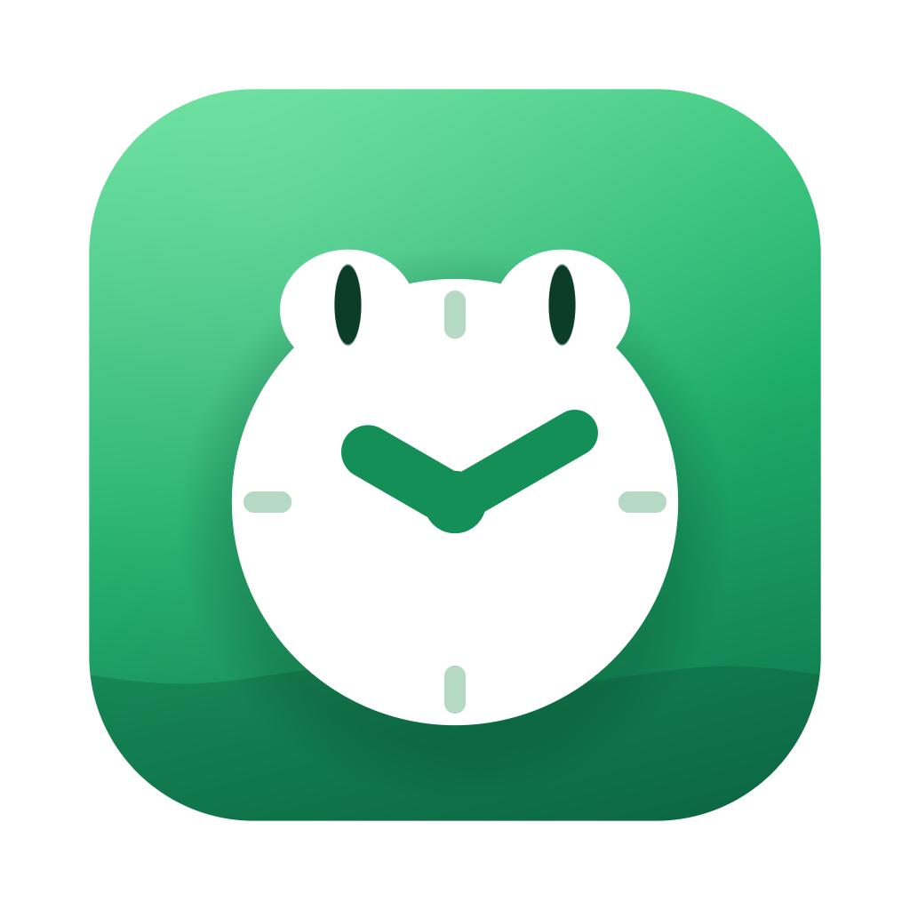
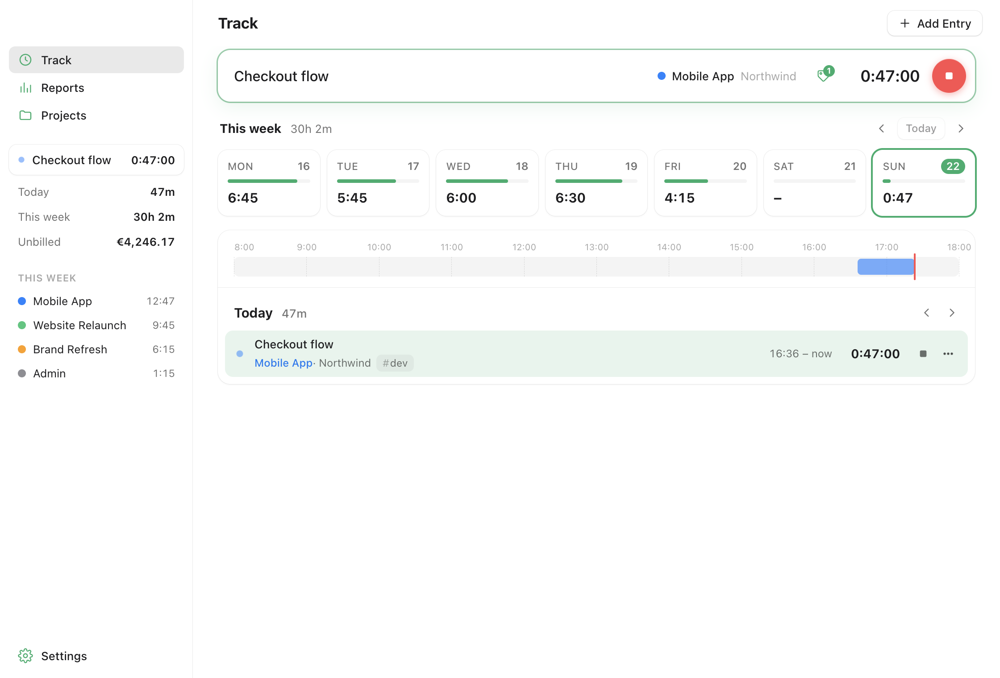
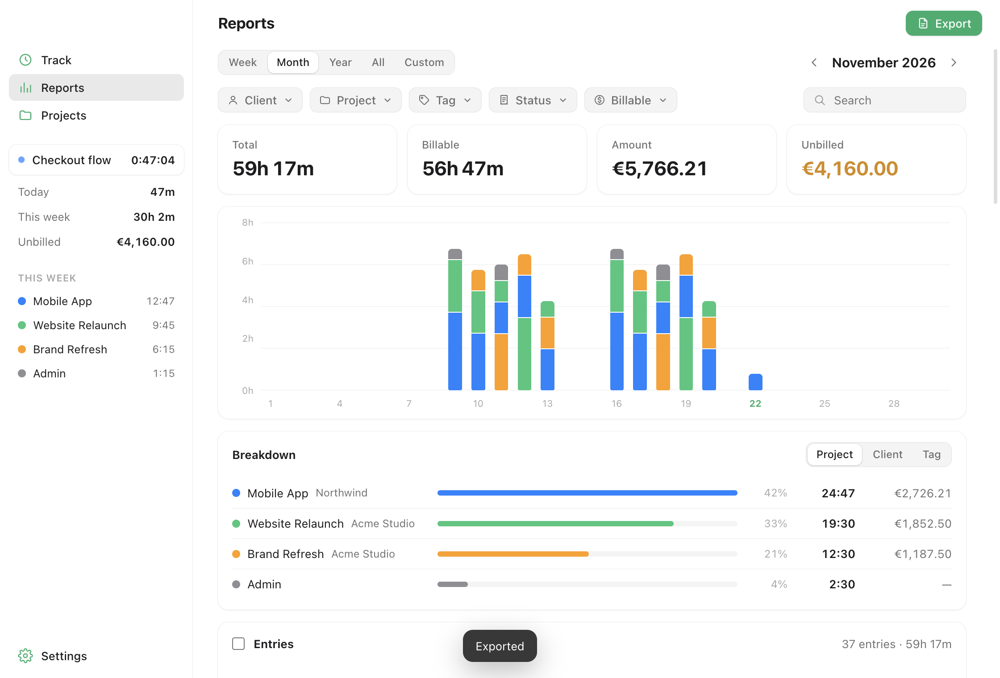

<p align="center"></p>

# Clockodile

**A free, open-source time tracker for people who bill by the hour.** Start a timer from the menu bar, or log time in one line. See your week at a glance, mark work as billed or paid, and send clients a clean PDF timesheet.



> **Status:** early (v0.1.x). Built and tested on macOS; Windows and Linux builds work too.

## Download
Get the latest build from [Releases](https://github.com/fabianfreund/Clockodile/releases/latest): a signed and notarized `.dmg` for macOS (Apple Silicon or Intel), an `.exe` installer for Windows, and an `.AppImage` / `.deb` for Linux. Or install it with one click from [Appetizer](https://github.com/fabianfreund/Appetizer-launcher).

## Highlights
- **Menu-bar timer:** the running time sits next to the icon. Click it (or press ⌥⇧T anywhere) to start, stop or restart recent work.
- **One click to clock in:** every project has a ▶, in the sidebar, in Projects and in Reports. The sidebar card shows what's running, or your last entry to continue.
- **Your sidebar:** right-click it to choose what it shows: today, this week, unbilled, and recent, pinned or all projects.
- **One-line quick entry:** type what you did, and Clockodile works out the rest.
- **Your week at a glance:** daily totals, a timeline of the day, and a list you can edit inline.
- **Billing built in:** hourly rates per client and project, billable / non-billable work, and an *unbilled → billed → paid* status on every entry.
- **Reports:** filter by period, client, project, tag and status. Charts, breakdowns, and bulk "mark as billed".
- **Export:** a clean A4 PDF timesheet (your header, a summary, entries grouped by project or day) or CSV in standard or Excel format. It can mark the exported work as billed in the same step.
- **Import from anywhere:** Timemator, Toggl, Clockify or any CSV with dates and times. Clients, projects and tags are created automatically, each entry keeps its original rate and billing status, and importing the same file twice adds nothing.
- **Idle detection:** when you come back after being away, Clockodile asks whether to keep or drop that time.
- **Private:** no account and no cloud. Everything is one JSON file on your computer, with daily backups.

## Quick entry
| You type | Clockodile does |
|---|---|
| `Homepage hero @website #design` | starts a timer on *Website* with tag *design* |
| `Client call 45m @acme` | logs 45 minutes ending now |
| `Standup 9:30-9:45 #meeting` | logs 09:30–09:45 today |
| `Invoices 1h yesterday @admin` | logs an hour yesterday |

`@project` matches project or client names (prefixes work). Unknown `#tags` are created for you.

## Shortcuts
| | |
|---|---|
| ⌥⇧T | open the menu-bar timer from anywhere (change it in Settings) |
| ⌘L | jump to the quick entry |
| ⌘. | stop the timer, or continue the last entry |
| ⌘N | new entry |
| ⌘[ / ⌘] / ⌘0 | previous day / next day / today |
| ⌘1 / ⌘2 / ⌘3 | Track / Reports / Projects |
| ⌘E | export |
| ⇧⌘I | import |

On Windows and Linux, use Ctrl instead of ⌘ and Alt instead of ⌥.



## Run from source
```bash
npm install
npm start          # your real data (in the app's user-data folder)
npm run demo       # two weeks of sample data in a throwaway profile; nothing is saved
npm run check      # lint + unit tests + end-to-end smoke test
npm run dist:mac   # or dist:win, dist:linux → dist/
```
Releases are one command: `npm run release:patch` tests, bumps the version, then builds, signs and notarizes the Mac version locally and publishes the GitHub Release. CI adds the Windows and Linux builds. Details in [docs/DEVELOPMENT.md](docs/DEVELOPMENT.md).

## Project layout
```
src/core/     data model, reducer, quick-entry parser, reports (pure JS, unit tested)
src/main/     Electron main process: database, menu bar, idle detection, PDF/CSV export
src/ui/       main window, menu-bar popover and the PDF template (plain ES modules + CSS)
scripts/      icon generator, smoke test, mac release (sign + notarize)
test/         unit tests (node:test)
```

## Built with
[Electron](https://www.electronjs.org) and [electron-builder](https://www.electron.build). Everything else is plain JavaScript, HTML and CSS, with no runtime dependencies. PDFs are rendered by Chromium's own print engine.

## About
Clockodile is made by **Fabian Builds** ([@fabianfreund](https://github.com/fabianfreund)) and is part of the [Appetizer](https://github.com/fabianfreund/Appetizer-launcher) collection, alongside [OneShot](https://github.com/fabianfreund/OneShot).

**Built with AI.** Most of Clockodile's code, design and docs were written with [Claude Code](https://claude.com/claude-code), steered and reviewed by a human. If you'd rather not use software made with AI tools, that's a fair choice, and there are great hand-made alternatives.

Clockodile is not affiliated with Timemator, Setapp or any other time tracker.

## License
[MIT](LICENSE).
